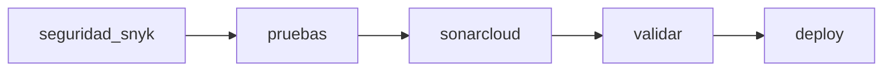

# Evaluación 2: Pipeline CI/CD con GitHub Actions
# Evaluación 3: Monitoreo

Microservicio de catálogo de álbumes (Spring Boot + PostgreSQL) con frontend en Nginx, contenerizado con Docker, orquestado con Docker Compose y desplegado automáticamente en AWS EC2 mediante un pipeline de GitHub Actions.

> **Evaluación Parcial N°2:** Ingeniería DevOps (DOY0101)

---

## Tabla de contenidos

1. [Arquitectura](#1-arquitectura)
2. [Contenedores](#2-contenedores-ie1--ie5)
3. [Pipeline CI/CD](#3-pipeline-cicd-ie2--ie3--ie4)
4. [Seguridad y gobernanza](#4-seguridad-y-gobernanza-ie3)
5. [Despliegue en AWS EC2](#5-despliegue-en-aws-ec2-ie4)
6. [Trazabilidad y calidad](#6-trazabilidad-y-calidad)
7. [Cómo ejecutar el proyecto](#7-cómo-ejecutar-el-proyecto)
8. [Uso de inteligencia artificial](#8-uso-de-inteligencia-artificial)
9. [Integrantes y conclusiones](#9-integrantes-y-conclusiones)

---

## 1. Arquitectura

| Componente | Tecnología | Función |
|---|---|---|
| **Backend** (`musica/`) | Spring Boot 4.1.1, Java 21, Maven | API REST del catálogo de álbumes |
| **Base de datos** | PostgreSQL 16 (Alpine) | Persistencia con volumen `musica-data` |
| **Frontend** (`frontend/`) | Nginx (Alpine), HTML/CSS/JS | Interfaz web y proxy hacia el backend |
| **Orquestación** | Docker Compose | Levanta los tres servicios en la red `musica-net` |
| **Despliegue** | AWS EC2 (Amazon Linux 2023) | Entorno de ejecución final |

### Estructura del repositorio

```text
.
├── .github/workflows/deploy.yml   # Pipeline CI/CD
├── docker-compose.yml             # Orquestación (postgres, backend, frontend)
├── frontend/                      # Nginx + sitio estático (Dockerfile propio)
└── musica/                        # Microservicio Spring Boot (Dockerfile propio)
```

---

## 2. Contenedores (IE1 / IE5)

- **Backend:** Dockerfile multi-etapa.
  - Etapa `build`: Maven 3.9.9 con Temurin 21.
  - Etapa final: `eclipse-temurin:21-jre-jammy`, con usuario sin privilegios (`app`) y límites de memoria de la JVM.
- **Frontend:** imagen `nginx:alpine` que copia el sitio estático y la configuración.
- **Compose:** define tres servicios con:
  - Healthchecks y dependencias (`depends_on` con `service_healthy`).
  - Límites de CPU y memoria.
  - Política `restart: unless-stopped`.
  - Red dedicada (`musica-net`).
  - Contraseña de Postgres leída desde la variable `POSTGRES_PASSWORD`.
- **Perfiles:** el backend usa el perfil `prod` en Compose (PostgreSQL) y H2 en memoria por defecto para desarrollo local.

---

## 3. Pipeline CI/CD (IE2 / IE3 / IE4)

Archivo: `.github/workflows/deploy.yml`

### Disparadores

| Evento | Resultado |
|---|---|
| `pull_request` hacia `main` | Ejecuta la integración continua, **sin desplegar** |
| `push` a `main` (merge del PR) | Ejecuta la integración **y además el despliegue** |

### Etapas (jobs)

| Etapa | Qué hace | Falla el pipeline si... |
|---|---|---|
| `seguridad_snyk` | Análisis de dependencias (SCA) con Snyk sobre `pom.xml` | Hay un error técnico del análisis |
| `pruebas` | `mvn clean verify`: pruebas unitarias y reporte de cobertura JaCoCo | Falla una prueba o la cobertura de líneas es menor al 50 % |
| `sonarcloud` | Análisis estático de calidad y seguridad en SonarQube Cloud | Falla la configuración o el análisis |
| `validar` | Valida archivos, sintaxis de Compose y construye las imágenes | Falta un archivo o falla el build |
| `deploy` | Copia el proyecto a la EC2 y levanta el stack con Compose | Falla SSH, Docker o el frontend no responde |

Las etapas se ejecutan en cadena (`needs`): si una falla, las siguientes no se ejecutan y el despliegue no ocurre.



### Reportes generados

| Reporte | Tipo | Contenido |
|---|---|---|
| `snyk-report` | Artefacto | Resultado del escaneo de dependencias en JSON |
| `jacoco-musica` | Artefacto | Reporte HTML de cobertura de pruebas |
| Panel de SonarQube Cloud | Panel web | Calidad, seguridad y Quality Gate por Pull Request |

---

## 4. Seguridad y gobernanza (IE3)

- Los tokens y credenciales se guardan en **GitHub Secrets**, nunca en el código.
- Se bloquea el despliegue si falla cualquier etapa previa (pruebas, análisis o validación).
- **JaCoCo** exige una cobertura mínima de líneas del 50 %.
- **Snyk** analiza las dependencias con umbral de severidad alta.
- **SonarQube Cloud** analiza cada Pull Request con su Quality Gate (calificación mínima A en seguridad sobre el código nuevo).
- Las acciones de terceros se fijan a un commit específico (SHA) y el Maven Wrapper se ejecuta con permisos explícitos.
- Los contenedores del backend se ejecutan con usuario sin privilegios y con memoria y CPU limitadas.

### Secretos requeridos en GitHub

| Secreto | Uso |
|---|---|
| `SNYK_TOKEN` | Autenticación de Snyk |
| `SONAR_TOKEN` | Autenticación de SonarQube Cloud |
| `SONAR_ORGANIZATION` | Organización en SonarQube Cloud |
| `SONAR_PROJECT_KEY` | Clave del proyecto en SonarQube Cloud |
| `AWS_HOST` | IP pública de la instancia EC2 |
| `AWS_USER` | Usuario SSH (`ec2-user`) |
| `AWS_SSH_KEY` | Clave privada `.pem` de la instancia |

---

## 5. Despliegue en AWS EC2 (IE4)

1. El workflow abre una conexión SSH con la instancia.
2. Espera a que Docker y Docker Compose estén disponibles.
3. Empaqueta el repositorio (sin `.git`, `target` ni `.env`) y lo copia a `/opt/musica/current`.
4. Ejecuta `docker compose up -d --build --remove-orphans`.
5. Verifica que el frontend responda en el puerto 80 antes de dar el despliegue por exitoso.

### Requisitos de la instancia

- Docker.
- Plugin Docker Compose v2.
- Plugin Docker Buildx (versión 0.17 o superior).
- Security group con los puertos **22** (SSH) y **80** (HTTP) abiertos.

---

## 6. Trazabilidad y calidad

### Trazabilidad

- Cada despliegue está asociado a un commit y a un Pull Request de `dev` hacia `main`.
- La pestaña *Actions* conserva el registro de cada ejecución, con el detalle de cada etapa.
- Las imágenes se construyen con la etiqueta `IMAGE_TAG` (por defecto `latest`), lo que permite versionarlas por commit.
- Los artefactos (Snyk y JaCoCo) quedan adjuntos a cada ejecución.
- `concurrency` asegura que no corran dos despliegues a producción a la vez.

### Calidad

- Pruebas automatizadas en cada Pull Request, con umbral de cobertura.
- Análisis estático y de seguridad antes de poder integrar a `main`.
- Validación de la sintaxis de Compose y del build de las imágenes antes del despliegue.

---

## 7. Cómo ejecutar el proyecto

### Localmente

```bash
git clone https://github.com/MatiDroid1/2026_2_DEVOPS_802V_Ev2.git
cd 2026_2_DEVOPS_802V_Ev2
docker compose up -d --build
```

La aplicación queda disponible en <http://localhost/>.

Para detenerla:

```bash
docker compose down
```

### Flujo de trabajo

1. Se desarrolla en la rama `dev`.
2. Se abre un Pull Request hacia `main`: el pipeline ejecuta la integración continua.
3. Al hacer *merge*, el pipeline despliega automáticamente en la EC2.

---

## 8. Uso de inteligencia artificial

> Se empleó inteligencia artificial, específicamente Perplexity, como apoyo durante el desarrollo del proyecto. Su uso se centró en orientar la interpretación de errores, reforzar conocimientos y explicar cómo podían solucionarse.Hubo momentos en que la IA se equivocaba o proponía "soluciones" que sabíamos que no resolvían el problema de lleno, por lo que cada respuesta que generaba, pasaba primero por la revisión y comprensión del equipo antes de implementar.  


---

## 9. Integrantes y conclusiones


Matias: A través del desarrollo de este caso conseguí repasar y fortalecer mis conocimientos sobre lo que significa preparar un despliegue, manteniendo seguridad y observabilidad en ella. La integración de Github Actions con controles automatizados como SonarQube o Snyk conseguí entender cómo revisar la calidad del código de un proyecto para así prevenir vulnerabilidades futuras para que estas no pasen a un entorno de producción. Además que pude reforzar la migración hacia EKS, manteniendo la persistencia con PostgreSQL, sumada a las métricas personalizadas para ir viendo el estado de la EC2 donde habita el proyecto. Con ello pude comprender la visibilidad y resiliencia de una arquitectura con microservicios, complementar con Amazon SNS para los avisos lo que hace que el proyecto sea auditable, tolerante a fallos y el uso de buenas prácticas para futuros proyectos.

Keiton: Mi rol se centró en la evolución de la arquitectura hacia la orquestación de contenedores y la observabilidad en la nube: configuración del clúster en Amazon EKS, gestión del almacenamiento persistente para PostgreSQL, integración de las métricas del backend y CI/CD en Amazon CloudWatch, y la configuración de alertas automatizadas mediante Amazon SNS. Los mayores desafíos estuvieron en asegurar que la comunicación interna entre los componentes en Kubernetes y la recolección de logs y métricas JVM funcionaran de manera estable, además de calibrar las reglas de seguridad en Snyk para detener efectivamente el pipeline ante vulnerabilidades críticas. Este proyecto reforzó en la práctica la importancia de la observabilidad y la seguridad continua en DevOps: no basta con automatizar el despliegue, sino que es indispensable contar con visibilidad en tiempo real y controles estrictos que impidan que código vulnerable llegue a producción. Finalmente, destaco nuevamente que el trabajo colaborativo con mi compañero fue fundamental para abordar la complejidad de esta entrega, complementando nuestras habilidades técnicas y criterios para resolver los inconvenientes durante la implementación.


Prueba 3
# Evaluación 3: observabilidad y controles de seguridad en AWS

Esta etapa extiende el proyecto de catálogo de música y su pipeline CI/CD mediante un despliegue en Amazon EKS, la incorporación de observabilidad con Amazon CloudWatch y la ejecución de controles de calidad y seguridad.

La aplicación está compuesta por un frontend desarrollado con HTML, CSS y JavaScript, un backend con Java 21 y Spring Boot, y una base de datos PostgreSQL.

## Objetivos

- Desplegar los componentes de la aplicación en Kubernetes sobre AWS.
- Comprobar la comunicación interna y el estado de los servicios.
- Centralizar logs y visualizar métricas de la aplicación.
- Incorporar al dashboard resultados del proceso CI/CD.
- Ejecutar controles automatizados de calidad y seguridad.
- Configurar notificaciones de infraestructura mediante CloudWatch y Amazon SNS.

## Tecnologías utilizadas

| Tecnología | Uso |
| --- | --- |
| GitHub Actions | Ejecución del pipeline CI/CD. |
| JaCoCo | Generación del reporte de cobertura de pruebas. |
| SonarQube Cloud | Análisis de calidad y evaluación del Quality Gate. |
| Snyk | Análisis de vulnerabilidades en dependencias. |
| Amazon ECR | Almacenamiento de imágenes de contenedores. |
| Amazon EKS | Ejecución de la aplicación en Kubernetes. |
| PostgreSQL | Persistencia de los datos de la aplicación. |
| Spring Boot Actuator | Exposición de endpoints de salud y métricas. |
| Amazon CloudWatch | Consulta de logs, métricas, dashboards y alarmas. |
| Amazon SNS | Envío de notificaciones por correo electrónico. |

## Entorno de despliegue

| Recurso | Configuración documentada |
| --- | --- |
| Región de AWS | `us-east-1` |
| Clúster EKS | `musica-ev3-v2` |
| Namespace de Kubernetes | `musica` |
| Grupo de nodos | `musica-nodos-v2` |
| Tipo de instancia del nodo | `t3.medium` |
| Sistema operativo del nodo | Amazon Linux 2023 |
| Rama utilizada | `ev3-kubernetes` |
| Workflow | `deploy.yml` |

En el namespace `musica` se desplegaron el frontend, el backend y PostgreSQL.

Durante la validación documentada, los tres componentes presentaron una réplica disponible y sus pods se encontraban en estado `Running`.

### Almacenamiento de PostgreSQL

Se verificó el enlace de los siguientes recursos:

- PersistentVolume: `musica-postgres-pv`.
- PersistentVolumeClaim: `postgres-data`.
- Capacidad declarada: `2 GiB`.
- Modo de acceso: `ReadWriteOnce`.
- Política de recuperación del volumen: `Retain`.
- Estado observado del enlace: `Bound`.

Posteriormente se comprobó el arranque de PostgreSQL y la conexión del backend con la base de datos.

## Pipeline CI/CD

El workflow integra las siguientes actividades:

1. Ejecución de pruebas y generación del reporte de cobertura.
2. Análisis de calidad con SonarQube Cloud.
3. Análisis de dependencias con Snyk.
4. Publicación de imágenes en Amazon ECR, cuando los controles configurados permiten continuar.
5. Despliegue en Amazon EKS y comprobación de los rollouts.
6. Publicación de métricas del proceso CI/CD en CloudWatch.

### Resultados documentados

| Indicador | Resultado |
| --- | --- |
| Cobertura de líneas | `96,15 %` |
| Cobertura presentada en el dashboard | `96,2 %`, por redondeo |
| Duración del segmento de despliegue medido | `39 segundos` |
| Duración total del workflow exitoso | `3 minutos y 25 segundos` |
| Quality Gate de SonarQube Cloud | `PASSED` en la ejecución presentada |

La duración de 39 segundos corresponde al segmento comprendido desde la actualización del backend hasta la finalización de ambos rollouts. No corresponde a la duración total del workflow.

Los valores describen ejecuciones específicas y no garantizan que todas las ejecuciones futuras tengan los mismos resultados.

### Análisis de seguridad

En una ejecución de Snyk se analizaron 98 dependencias y se detectaron dos vulnerabilidades: una de severidad alta y otra crítica. El paso finalizó con código de salida `1`.

La ejecución con hallazgos y la ejecución posterior exitosa deben interpretarse por separado. Un resultado posterior exitoso no demuestra, por sí solo, que las vulnerabilidades hayan sido corregidas.

Los reportes y el historial de GitHub Actions permiten revisar el resultado de cada control y la continuidad de los trabajos posteriores.

## Observabilidad con Amazon CloudWatch

### Integración con EKS

Se instaló el add-on Amazon CloudWatch Observability en el clúster `musica-ev3-v2`.

Durante la verificación se comprobó:

- La ejecución de los componentes de observabilidad.
- La recepción de logs.
- La recepción de muestras de `cluster_node_count`, con un nodo reportado.

La configuración documentada conservó `monitorAllServices: false`. La recolección del backend se configuró de forma específica.

### Endpoints del backend

Se verificaron los siguientes endpoints mediante el servicio interno del backend:

| Endpoint | Resultado observado |
| --- | --- |
| `/actuator/health` | Estado `UP`. |
| `/actuator/prometheus` | Respuesta HTTP `200` y exposición de métricas. |

Dirección interna utilizada para la recolección:

```text
http://musica.musica.svc.cluster.local:8080/actuator/prometheus
```

Esta dirección corresponde al servicio interno de Kubernetes, no a una URL pública de acceso.

### Métricas del backend

Se configuró un intervalo de recolección de 60 segundos y el envío de métricas a CloudWatch mediante EMF.

| Recurso | Valor |
| --- | --- |
| Namespace de métricas | `Musica/Backend` |
| Grupo de logs | `/aws/containerinsights/musica-ev3-v2/prometheus` |

Métricas seleccionadas:

| Métrica | Descripción |
| --- | --- |
| `jvm_memory_used_bytes` | Memoria utilizada por los pools de la JVM. |
| `jvm_threads_live_threads` | Cantidad de hilos activos de la JVM. |
| `process_uptime_seconds` | Tiempo transcurrido desde el inicio del proceso. |

### Dashboard

El dashboard `musica-ev3-observabilidad` reúne información de:

- Uso de CPU y memoria.
- Estado de preparación de componentes.
- Logs del frontend y del backend.
- Errores registrados.
- Métricas de la JVM.
- Cobertura de pruebas.
- Duración del despliegue.

Las métricas de cobertura y duración se publicaron desde GitHub Actions en el namespace `Musica/CICD`.

### Interpretación de logs

En el intervalo consultado se encontraron errores históricos de conexión del backend hacia `postgres:5432`.

Estos registros corresponden a intentos de conexión durante un arranque anterior. No se utilizan como evidencia de que PostgreSQL continuaba fallando después del despliegue validado.

## Notificaciones con Amazon SNS

Como monitoreo complementario de infraestructura, se configuró una alarma para la instancia EC2 `evaluacion2`.

| Campo | Configuración |
| --- | --- |
| Alarma | `evaluacion2-ec2-salud` |
| Instancia supervisada | `i-0393e7101782d6393` |
| Namespace | `AWS/EC2` |
| Métrica | `StatusCheckFailed` |
| Estadística | Máximo |
| Período | 1 minuto |
| Umbral | Mayor o igual a `1` |
| Puntos de datos | `2 de 2` |
| Datos ausentes | Tratados como faltantes |
| Estado que activa la notificación | `ALARM` |
| Tema SNS | `musica-ev3-alertas` |
| Protocolo de suscripción | Correo electrónico |

Después de crear la alarma, la consola mostró el estado `CORRECTO` y las acciones habilitadas. También se recibió un correo de AWS Notifications asociado a la alarma.

La recepción del correo acredita la entrega de la notificación. Por sí sola, no acredita una falla real de la instancia ni una prueba de saturación de memoria.

Esta alarma supervisa la instancia EC2 indicada. No se presenta como una alarma del clúster EKS, ya que no se ha acreditado que dicha instancia pertenezca al clúster.

## Alcance de la automatización

Se distingue entre:

- Preparación del entorno: configuración inicial de EKS, almacenamiento, observabilidad, dashboard y recursos de notificación.
- Ejecución del pipeline: pruebas, análisis, publicación y despliegue según las condiciones del workflow, y publicación de métricas CI/CD.

No se considera que toda la infraestructura se recree automáticamente en cada ejecución del pipeline.

## Evidencias

Las evidencias del trabajo se encuentran  en el informe de la evaluación y en el historial de GitHub Actions:

- Estado de los componentes desplegados en EKS.
- Enlace del almacenamiento persistente de PostgreSQL.
- Validación de salud y métricas del backend.
- Dashboard de observabilidad.
- Resultados de pruebas, calidad y seguridad.
- Ejecución del despliegue.
- Configuración de la alarma y recepción del correo SNS.

