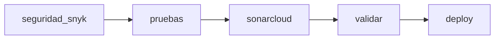

# Evaluación 2: Pipeline CI/CD con GitHub Actions

Microservicio de catálogo de álbumes (Spring Boot + PostgreSQL) con frontend en Nginx, contenerizado con Docker, orquestado con Docker Compose y desplegado automáticamente en AWS EC2 mediante un pipeline de GitHub Actions.

> **Evaluación Parcial N°2:** Ingeniería DevOps (DOY0101)

---

## Tabla de contenidos

1. [Arquitectura](#1-arquitectura)
2. [Contenedores](#2-contenedores-ie1--ie5)
3. [Pipeline CI/CD](#3-pipeline-cicd-ie2--ie3--ie4)
4. [Seguridad y gobernanza](#4-seguridad-y-gobernanza-ie3)
5. [Despliegue en AWS EC2](#5-despliegue-en-aws-ec2-ie4)
6. [Trazabilidad y calidad](#6-trazabilidad-y-calidad)
7. [Cómo ejecutar el proyecto](#7-cómo-ejecutar-el-proyecto)
8. [Uso de inteligencia artificial](#8-uso-de-inteligencia-artificial)
9. [Integrantes y conclusiones](#9-integrantes-y-conclusiones)

---

## 1. Arquitectura

| Componente | Tecnología | Función |
|---|---|---|
| **Backend** (`musica/`) | Spring Boot 4.1.1, Java 21, Maven | API REST del catálogo de álbumes |
| **Base de datos** | PostgreSQL 16 (Alpine) | Persistencia con volumen `musica-data` |
| **Frontend** (`frontend/`) | Nginx (Alpine), HTML/CSS/JS | Interfaz web y proxy hacia el backend |
| **Orquestación** | Docker Compose | Levanta los tres servicios en la red `musica-net` |
| **Despliegue** | AWS EC2 (Amazon Linux 2023) | Entorno de ejecución final |

### Estructura del repositorio

```text
.
├── .github/workflows/deploy.yml   # Pipeline CI/CD
├── docker-compose.yml             # Orquestación (postgres, backend, frontend)
├── frontend/                      # Nginx + sitio estático (Dockerfile propio)
└── musica/                        # Microservicio Spring Boot (Dockerfile propio)
```

---

## 2. Contenedores (IE1 / IE5)

- **Backend:** Dockerfile multi-etapa.
  - Etapa `build`: Maven 3.9.9 con Temurin 21.
  - Etapa final: `eclipse-temurin:21-jre-jammy`, con usuario sin privilegios (`app`) y límites de memoria de la JVM.
- **Frontend:** imagen `nginx:alpine` que copia el sitio estático y la configuración.
- **Compose:** define tres servicios con:
  - Healthchecks y dependencias (`depends_on` con `service_healthy`).
  - Límites de CPU y memoria.
  - Política `restart: unless-stopped`.
  - Red dedicada (`musica-net`).
  - Contraseña de Postgres leída desde la variable `POSTGRES_PASSWORD`.
- **Perfiles:** el backend usa el perfil `prod` en Compose (PostgreSQL) y H2 en memoria por defecto para desarrollo local.

---

## 3. Pipeline CI/CD (IE2 / IE3 / IE4)

Archivo: `.github/workflows/deploy.yml`

### Disparadores

| Evento | Resultado |
|---|---|
| `pull_request` hacia `main` | Ejecuta la integración continua, **sin desplegar** |
| `push` a `main` (merge del PR) | Ejecuta la integración **y además el despliegue** |

### Etapas (jobs)

| Etapa | Qué hace | Falla el pipeline si... |
|---|---|---|
| `seguridad_snyk` | Análisis de dependencias (SCA) con Snyk sobre `pom.xml` | Hay un error técnico del análisis |
| `pruebas` | `mvn clean verify`: pruebas unitarias y reporte de cobertura JaCoCo | Falla una prueba o la cobertura de líneas es menor al 50 % |
| `sonarcloud` | Análisis estático de calidad y seguridad en SonarQube Cloud | Falla la configuración o el análisis |
| `validar` | Valida archivos, sintaxis de Compose y construye las imágenes | Falta un archivo o falla el build |
| `deploy` | Copia el proyecto a la EC2 y levanta el stack con Compose | Falla SSH, Docker o el frontend no responde |

Las etapas se ejecutan en cadena (`needs`): si una falla, las siguientes no se ejecutan y el despliegue no ocurre.



### Reportes generados

| Reporte | Tipo | Contenido |
|---|---|---|
| `snyk-report` | Artefacto | Resultado del escaneo de dependencias en JSON |
| `jacoco-musica` | Artefacto | Reporte HTML de cobertura de pruebas |
| Panel de SonarQube Cloud | Panel web | Calidad, seguridad y Quality Gate por Pull Request |

---

## 4. Seguridad y gobernanza (IE3)

- Los tokens y credenciales se guardan en **GitHub Secrets**, nunca en el código.
- Se bloquea el despliegue si falla cualquier etapa previa (pruebas, análisis o validación).
- **JaCoCo** exige una cobertura mínima de líneas del 50 %.
- **Snyk** analiza las dependencias con umbral de severidad alta.
- **SonarQube Cloud** analiza cada Pull Request con su Quality Gate (calificación mínima A en seguridad sobre el código nuevo).
- Las acciones de terceros se fijan a un commit específico (SHA) y el Maven Wrapper se ejecuta con permisos explícitos.
- Los contenedores del backend se ejecutan con usuario sin privilegios y con memoria y CPU limitadas.

### Secretos requeridos en GitHub

| Secreto | Uso |
|---|---|
| `SNYK_TOKEN` | Autenticación de Snyk |
| `SONAR_TOKEN` | Autenticación de SonarQube Cloud |
| `SONAR_ORGANIZATION` | Organización en SonarQube Cloud |
| `SONAR_PROJECT_KEY` | Clave del proyecto en SonarQube Cloud |
| `AWS_HOST` | IP pública de la instancia EC2 |
| `AWS_USER` | Usuario SSH (`ec2-user`) |
| `AWS_SSH_KEY` | Clave privada `.pem` de la instancia |

---

## 5. Despliegue en AWS EC2 (IE4)

1. El workflow abre una conexión SSH con la instancia.
2. Espera a que Docker y Docker Compose estén disponibles.
3. Empaqueta el repositorio (sin `.git`, `target` ni `.env`) y lo copia a `/opt/musica/current`.
4. Ejecuta `docker compose up -d --build --remove-orphans`.
5. Verifica que el frontend responda en el puerto 80 antes de dar el despliegue por exitoso.

### Requisitos de la instancia

- Docker.
- Plugin Docker Compose v2.
- Plugin Docker Buildx (versión 0.17 o superior).
- Security group con los puertos **22** (SSH) y **80** (HTTP) abiertos.

---

## 6. Trazabilidad y calidad

### Trazabilidad

- Cada despliegue está asociado a un commit y a un Pull Request de `dev` hacia `main`.
- La pestaña *Actions* conserva el registro de cada ejecución, con el detalle de cada etapa.
- Las imágenes se construyen con la etiqueta `IMAGE_TAG` (por defecto `latest`), lo que permite versionarlas por commit.
- Los artefactos (Snyk y JaCoCo) quedan adjuntos a cada ejecución.
- `concurrency` asegura que no corran dos despliegues a producción a la vez.

### Calidad

- Pruebas automatizadas en cada Pull Request, con umbral de cobertura.
- Análisis estático y de seguridad antes de poder integrar a `main`.
- Validación de la sintaxis de Compose y del build de las imágenes antes del despliegue.

---

## 7. Cómo ejecutar el proyecto

### Localmente

```bash
git clone https://github.com/MatiDroid1/2026_2_DEVOPS_802V_Ev2.git
cd 2026_2_DEVOPS_802V_Ev2
docker compose up -d --build
```

La aplicación queda disponible en <http://localhost/>.

Para detenerla:

```bash
docker compose down
```

### Flujo de trabajo

1. Se desarrolla en la rama `dev`.
2. Se abre un Pull Request hacia `main`: el pipeline ejecuta la integración continua.
3. Al hacer *merge*, el pipeline despliega automáticamente en la EC2.

---

## 8. Uso de inteligencia artificial

> Se empleó inteligencia artificial, específicamente Perplexity, como apoyo durante el desarrollo del proyecto. Su uso se centró en orientar la interpretación de errores, reforzar conocimientos y explicar cómo podían solucionarse.Hubo momentos en que la IA se equivocaba o proponía "soluciones" que sabíamos que no resolvían el problema de lleno, por lo que cada respuesta que generaba, pasaba primero por la revisión y comprensión del equipo antes de implementar.  


---

## 9. Integrantes y conclusiones

| Integrante | Rol / contribución |
|---|---|
| Keiton | _Completar_ |

Matias: Durante la ejecución de este trabajo logre reforzar el despliegue de una aplicación usando docker en AWS. Mi rol se centró en el diseño de la página web, ajustar los estilos y colaborar en el despliegue. 
Las dificultades a las que me enfrenté fueron en el despliegue en si, el pipeline tuvo varios errores al momento de ejecutar Github Actions, estás fueron en dar los permisos al maven wrapper, la estructuración del archivo deploy.yml y la configuración de SonarCloud y snyk.
Estas dificultades las fuí resolviendo viendo los ejemplos del profesor, he visto los repositorios que ha dejado durante las sesiones anteriores para poder ir orientandome en su construcción.
Pero admito que hubieron errores que tuve que investigar en internet para poder dar con la solución, un ejemplo de ello fueron los permisos de mvnw que pedían permiso de ejecución. Teniendo que aplicar un chmod +x mvnw para que así pudiera ejecutar los comandos maven para el proyecto de spring.
Lo que reforcé con este proyecto fue el proceso de armar un despliegue con Actions, porque a diferencia de los trabajos anteriores este contempló más pasos, por ende tuve que ver las nuevas configuraciones, los test de jacoco y su implementación para poder dar con el resultado.


